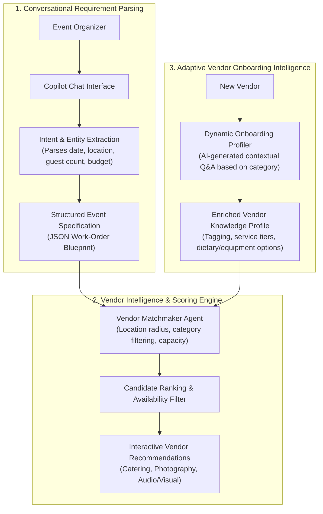

# 🤖 Marketplace Event AI Copilot & Vendor Matchmaker
### *Conversational Requirement Parsing, Dynamic Vendor Recommendations, and Adaptive Profile Intelligence*

[](https://nestjs.com/)
[](https://www.typescriptlang.org/)
[](https://huggingface.co/)
[](https://www.prisma.io/)
[](https://nextjs.org/)
[](LICENSE)

An intelligent event scaffolding and vendor matching copilot engineered for two-sided marketplace platforms. Converts raw, conversational organizer requirements (e.g., *"50-person corporate summit in Brooklyn with vegan catering and AV equipment"*) into structured event work-orders, generates dynamic vendor candidate match scores, and powers an adaptive multi-turn vendor onboarding questionnaire.

---

## 🏗️ System Architecture



---

## ✨ Production Architectural Highlights

* **Conversational Intent Extraction:** Extracts structured schemas (budget bounds, guest counts, geographic radiuses, catering restrictions) from free-form natural language.
* **Multi-Factor Vendor Matchmaker:** Scores vendor candidates using category specialization, geographical proximity, service capacity, and rating matrices.
* **Adaptive Vendor Onboarding Q&A:** Dynamically generates contextual follow-up questions tailored to a vendor's selected category (e.g., asking a caterer about commercial kitchen licensing and dietary certifications).
* **Deterministic Fallback Routing:** Gracefully falls back to rule-based keyword and geographic matching whenever external LLM inference quotas or latency thresholds are exceeded.
* **Structured Work-Order Blueprints:** Automatically binds confirmed vendor recommendations into immutable work-order contracts ready for escrow funding.

---

## 🛠️ Technology Stack

* **Backend Framework:** NestJS v10 (TypeScript)
* **AI & NLP:** HuggingFace Inference API / LLM Prompt Pipelines
* **Database & ORM:** PostgreSQL / Prisma ORM v6
* **Frontend:** Next.js 15, React 19, Tailwind CSS
* **Authentication:** JWT, Passport.js, bcrypt

---

## 📁 Repository Structure

```text
├── frontend/
│   └── app/
│       └── events/
│           └── copilot/           # Interactive event chat & vendor matching UI
├── prisma/
│   └── schema.prisma              # Relational models (Event, Vendor, WorkOrder, User)
├── src/
│   ├── ai/                        # Natural language parsing & vendor match scoring
│   ├── auth/                      # JWT auth, guards, and passport strategies
│   ├── events/                    # Event blueprint models & lifecycle services
│   ├── payments/                  # Stripe payment processing for work-orders
│   ├── vendors/                   # Vendor catalog & dynamic profiling questionnaire
│   └── work-orders/               # Structured contract delivery and escrow state
└── nest-cli.json
```

---

## 🔌 Core API Endpoints

| Method | Endpoint | Description |
| :--- | :--- | :--- |
| `POST` | `/ai/events/parse` | Extracts structured event parameters from natural language |
| `POST` | `/ai/events/suggestions` | Generates ranked vendor category recommendations |
| `POST` | `/ai/vendors/chat` | Multi-turn conversational copilot for event planning |
| `POST` | `/ai/vendors/onboarding-questions` | Dynamically generates category-specific vendor Q&A |
| `POST` | `/events/create` | Commits validated AI blueprint into persistent event record |

---

## ⚡ Quickstart

```bash
# 1. Install dependencies
npm install

# 2. Configure environment variables
cp .env.example .env

# 3. Generate Prisma client & run migrations
npx prisma generate
npx prisma migrate dev

# 4. Start local development server
npm run start:dev
```
